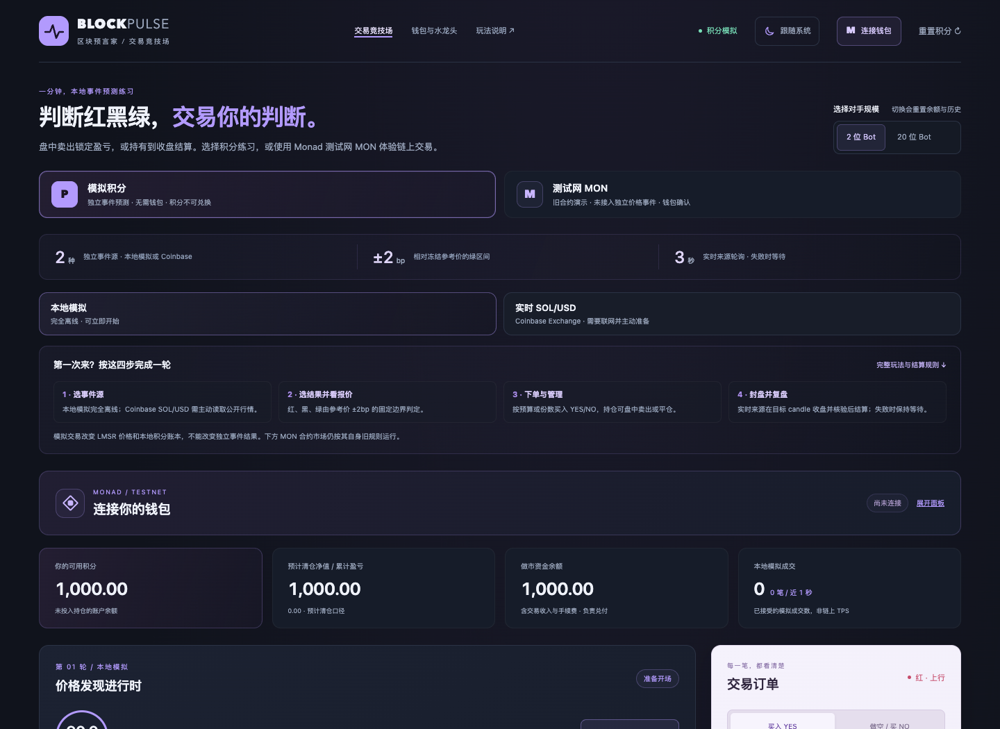
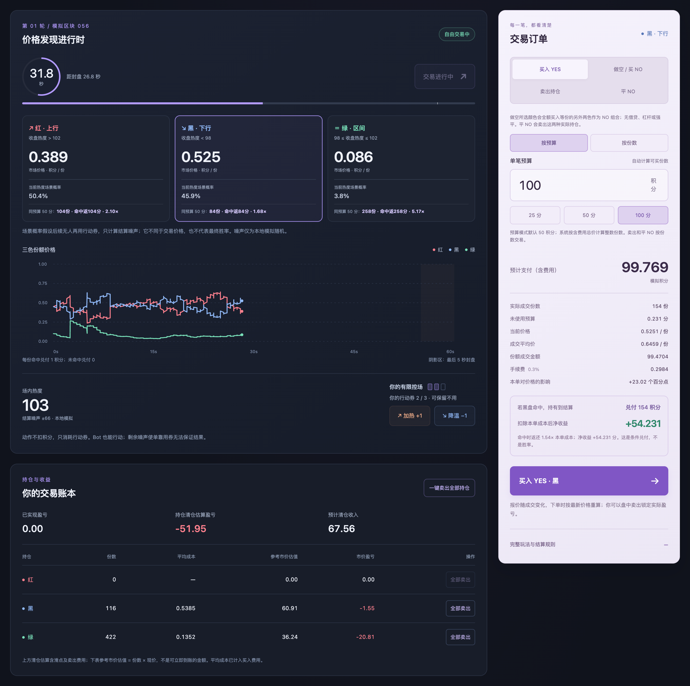
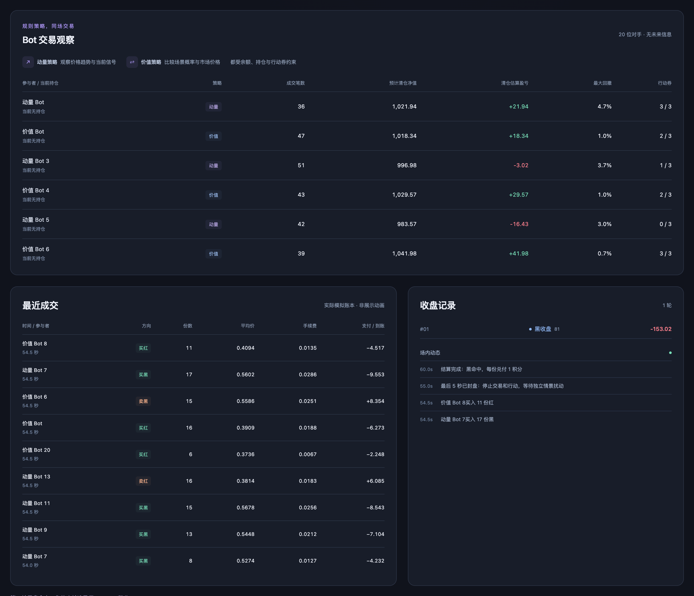
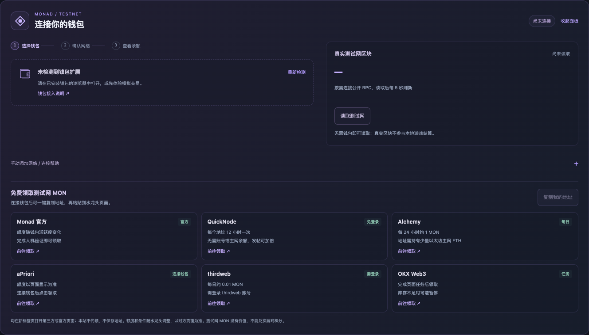
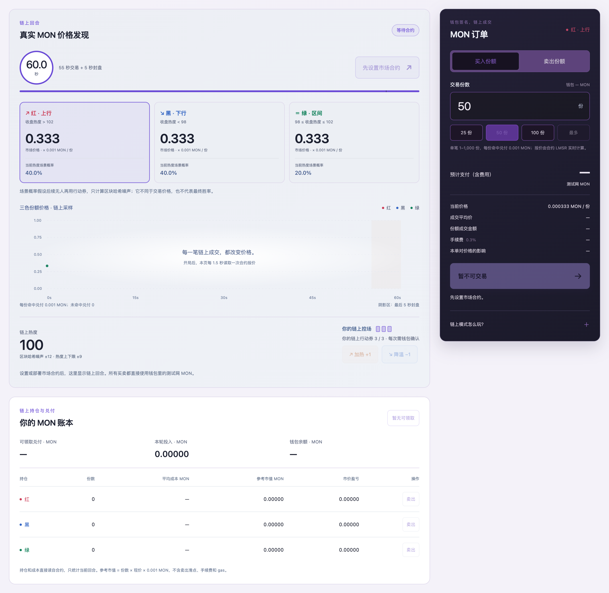

# BlockPulse · 轮盘 × 多空交易 × 量化策略的事件游戏

> 一边等结果，一边交易整个过程。追热门、押冷门、反手做空：提前落袋，还是持仓等到最终揭晓？

**[在线试玩](https://ailiheizi.github.io/blockpulse/)** · **[项目说明](docs/PROJECT.md)** · **[比赛提交说明](docs/SUBMISSION.md)**

打开即可用模拟积分试玩，无需钱包。先用一轮 60 秒的本地练习，体验从入场、交易到揭晓的完整过程。

[创意](#创意来自哪里) · [玩法闭环](#一局的玩法闭环) · [多空操作](#四种操作怎么选) · [一局与收益示例](#用一局看懂红黑绿与收益) · [量化与并发](#策略与并发) · [本地运行](#直接试玩) · [技术实现](#技术实现与协作)



## 项目介绍

选好一个结果之后，等待也能很好玩。**BlockPulse 把轮盘开奖的悬念、交易所的多空博弈和量化策略放进同一局游戏。**报价不断变化，你可以追随趋势、买入冷门、反手做空，也可以在封盘前退出，把这一刻的盈亏落袋。

**我们的愿景：让每个有趣、最终有明确结果的事件，都能成为一场可交易的游戏。**玩家选择自己感兴趣的事件，判断它会如何结束，再决定什么时候入场、什么时候改变立场、什么时候退出。红黑绿是结果的表达方式，事件可以不断换，交易与揭晓的玩法继续成立。

### 好玩，也可以很疯狂

- **热门越热，你越有选择。**继续买入红色，卖出已有持仓，或买 NO 押红不会发生。看好与看空都进入同一个市场，交易不断改变报价。
- **冷门留到揭晓，才知道能否翻盘。**低价买入的绿色若最终命中，每份同样兑付 1 积分，小众判断可能迎来反转；若未命中则兑付为 0。
- **每次波动都带来取舍。**眼前的收益要不要落袋？判断变了要不要离场？继续持有，就把悬念留到结算。
- **让策略也加入这场博弈。**练习场可开启价值或动量策略，用自己的积分实际买卖。市场报价影响策略决策，策略成交又改变报价。

当红色被追捧、绿色受到冷落，你可以先交易一段价格波动，也可以坚持自己的事件判断。过程中的报价会变，最终答案留给事件揭晓：**交易影响价格，事件决定结果。**

## 创意来自哪里

最初的想法很直接：选好一个结果后，等待开奖的这段时间还能做什么？我们希望把“押什么”延伸成“什么时候买、什么时候卖、什么时候改变判断”，让一局游戏从入场到揭晓都有选择。

| 组成 | 带来的乐趣 | 在 BlockPulse 中的作用 |
| --- | --- | --- |
| 轮盘式揭晓 | 红黑绿、倒计时、冷门反转 | 为不同结果提供直观的视觉表达，把悬念留到事件确认 |
| 交易所式操作 | 动态报价、多空选择、提前退出 | 买卖结果份额，在交易开放期间调整持仓、兑现波动 |
| 量化策略 | 规则判断、自动下单、策略竞争 | 练习场可让价值 / 动量策略使用玩家自己的积分实际交易 |
| 事件作为主题 | 对感兴趣的事情作判断 | 用事件最终结果结算，未来通过更多事件模板延展玩法 |

把这些机制放在一起，玩家就有了不同的参与方式：有人看好结果，愿意持有到期；有人判断报价变化，选择提前退出；有人押低价冷门，也有人用 NO 表达相反判断。不同订单汇入同一个市场，形成一局持续变化的交易过程。

我们希望“疯狂”来自这些选择相互碰撞：热门被追高时，有人继续买入，有人兑现离场，也有人反手买 NO；策略捕捉到新信号，又加入一轮交易。最终揭晓前，市场可以很热闹，事件仍按事先确定的规则给出答案。

### 一局的玩法闭环

**选事件 → 作判断 → 多空入场 → 交易 / 策略参与 → 提前退出或到期结算 → 复盘，再开一局。**

1. **选一个想判断的事件**，看清结果选项与揭晓时间。
2. **把判断变成持仓**：买 YES 押某个结果发生，买 NO 押它不发生。
3. **跟着进展作决定**：观察事件与报价，在交易开放期间追加、卖出或平 NO；练习场也可启用量化策略。
4. **选择如何结束这一笔**：封盘前按市场报价退出，或持有到期，按事件结果兑付。交易计入费用与滑点。
5. **看成绩，再来一局**：查看净盈亏与排名，带着新的判断继续参与。

这个点子来自一次临时灵感，我们把它赶成了可玩的黑客松原型。接下来，希望让更多事件、玩家和策略进入同一套玩法。

## 四种操作怎么选

交易的对象是**结果份额**：你买的是“某种结果发生时获得兑付的份额”。在当前积分玩法中，每份命中的结果兑付 1 积分，其余结果兑付 0。

| 你的判断 | 操作（以红色为例） | 持仓变化 | 如何结束 |
| --- | --- | --- | --- |
| 我认为红会赢，或红份额会涨价 | 买入红 YES | 获得红份额 | 封盘前卖出，或持有到期 |
| 我已经持有红，现在想退出 | 卖出红 | 减少已有红份额，收回当时报价对应的积分 | 已卖部分不再参与到期兑付 |
| 我认为红不会赢 | 买入 NO 红（做空） | 获得等量的黑、绿两种份额 | 黑或绿命中时，每组兑付 1 积分；红命中则为 0 |
| 我想退出之前的 NO 红 | 平 NO 红 | 同时卖回等量黑、绿份额 | 按两腿实际卖价收回积分，已卖部分不再兑付 |

例如 10 组 NO 红，就是 10 份黑加 10 份绿；因为最终只有一种颜色命中，所以最多兑付 10 积分。NO 全额支付买入成本，没有借币、杠杆或强平。单纯卖出则需要先持有对应份额。

改变立场时，买 NO 不会自动卖掉已有 YES。例如持有红时再买 NO 红，账户会同时持有红、黑、绿，形成一定程度的对冲；想完全换方向，需要先卖出原持仓，再建立新的持仓。

盘面上有三类容易混淆的数字：**市场报价**决定买卖成本，**模型估计**是练习场策略对事件的估算，**命中回报**是该结果真的发生时才成立的兑付。它们各自回答不同的问题，报价不等于真实胜率。

## 用一局看懂红黑绿与收益

### 谁决定最终颜色

以当前本地练习为例，开局参考价为 100 USD，固定下界 99.98、上界 100.02。一轮 60 秒，通常前 55 秒交易，最后 5 秒封盘等待结果。

| 事件最终价格 | 最终颜色 | 红 YES | NO 红（黑 + 绿） |
| --- | --- | --- | --- |
| 100.03，高于上界 | 红 | 每份兑付 1 | 每组兑付 0 |
| 99.97，低于下界 | 黑 | 每份兑付 0 | 每组兑付 1 |
| 100.00，在区间内 | 绿 | 每份兑付 0 | 每组兑付 1 |

正好 99.98 或 100.02 也属于绿。这里的“最终价格”是事件的价格；红黑绿份额在盘面上的交易报价是另一组数值。本地局由独立模拟路径的末价判色，真实 SOL/USD 局由指定分钟收盘价判色，详见[两种事件](#两种事件)。

### 持有到期与提前退出

以下是便于算账的假设成交，**各案例独立，不代表同一市场同时可获得的报价**；所列均价已代表整笔成交价格，费用另计。实际数量会影响成交均价，以页面最新报价为准。

| 选择 | 支出（含买入费） | 后续结果 | 收回积分 | 净盈亏 |
| --- | --- | --- | --- | --- |
| 100 份红 YES，均价 0.40 | 40 + 0.12 = 40.12 | 持有到期，红命中 | 100 | +59.88 |
| 同样买入 100 份红 YES | 40.12 | 持有到期，黑或绿命中 | 0 | −40.12 |
| 同样买入 100 份红 YES | 40.12 | 封盘前以均价 0.60 全部卖出 | 60 − 0.18 卖出费 = 59.82 | +19.70 |
| 100 份绿 YES，均价 0.10 | 10 + 0.03 = 10.03 | 持有到期，绿命中 | 100 | +89.97 |
| 100 组 NO 红；黑均价 0.30、绿均价 0.10 | 30 + 10 + 0.09 + 0.03 = 40.12 | 持有到期，黑或绿命中 | 100 | +59.88 |
| 同样买入 100 组 NO 红 | 40.12 | 持有到期，红命中 | 0 | −40.12 |

这就是“冷门反转”的来源：入场成本低，但命中后的每份兑付相同。示例中绿色若未命中，会损失投入的 10.03 积分。提前卖出则锁定当时的实际盈亏，已经卖出的份额不会再领取到期兑付。

每一轮结束，按**本轮结算后余额 − 本轮开始余额**排名，交易费用已经计入。下一轮保留积分与累计统计，再开始新的事件。

## 当前 Demo 实现

当前可选离线模拟价格与真实 SOL/USD 两个预设；任意事件建局属于扩展方向。真实事件读取 Coinbase Exchange SOL-USD 的指定一分钟 K 线收盘价，仍使用模拟积分。Monad 钱包和 MON 合约演示保留为独立入口。

- **同一盘口，四种操作**：买入 YES、卖出已有份额、买入 NO 做空、平 NO，均进入同一套三结果 LMSR 做市和积分账本。
- **事件独立**：下注数量、下单频率、Bot 和个人策略都不能改变事件价格路径或结算区间。积分预测玩法已移除行动券、热度让分和忙区块量结算。
- **看清成本再成交**：默认每单 50 积分预算，可切换整数份数，预览均价、滑点、0.3% 手续费、条件兑付和收益倍数。
- **个人量化**：练习场可配置策略、每单份数、总持仓上限和触发优势，使用自己的积分实际成交。真实行情模式暂不启用未校准的自动策略。
- **真实账本**：每份命中兑付 1 积分，其他兑付 0。参与者与做市账户现金守恒；净值按含费用的实际清仓路径估算，自己拉高价格不等于已兑现盈利。
- **结果已知不再开仓**：交易入口和引擎同时核对截止条件；本地路径若在合法的剩余变化范围内已确定同一结果，会提前封盘，不依赖“四舍五入概率为100%”。

这里的“独立”指结果不受本局订单和游戏内操作影响，不表示行情源绝对不可操纵。当前为浏览器内积分原型，未提供资金托管、服务器权威裁决或经合约验证的价格预言机。离线练习的种子和状态可在客户端读取，因此它不是防作弊或可验证的随机源。

## 两种事件

| 项目 | 本地独立练习 | 真实 SOL/USD |
| --- | --- | --- |
| 数据 | 独立随机序列生成的模拟价格 | Coinbase Exchange SOL-USD 公开行情 |
| 基准 | 模拟开局价格 100 USD | 准备时最新完整一分钟 K 线的收盘价 |
| 红 / 黑 / 绿 | 高于上界 / 低于下界 / 区间内（含边界） | 同左 |
| 固定区间 | 基准上下各 2 个基点，即 ±0.02% | 同左，开局冻结并公开 |
| 截止 | 通常前 55 秒交易、最后 5 秒封盘 | 目标时间前 15 秒封盘 |
| 目标 | 一轮 60 秒的模拟末价 | 准备时选定的未来整分钟，约 60–120 秒后 |
| 最终依据 | 独立模拟路径的最后一个价格 | 精确目标分钟 K 线的 close，绝不以最新 ticker 替代 |
| 无数据 | 可离线游玩 | 显示等待 / 重试，不生成模拟结果 |

上下界使用整数微美元计算并冻结。红严格高于上界，黑严格低于下界；刚好等于上界或下界均归绿。单个事件的规则与来源会在面板中显示。

### 真实价格如何取数

点击真实事件入口后，读取 Coinbase 服务端时间；取准备时最新完整分钟 K 线的收盘价作为基准。目标时间固定为服务端当前分钟起点之后的第 120 秒，截止为目标前 15 秒。例如目标是 12:02:00 UTC，最终只接受 12:01:00–12:02:00 这一分钟的收盘价。

目标结束后再等 10 秒发布缓冲，读取 `granularity=60` 且 bucket 时间**精确等于目标减60秒**的 K 线。返回列表可能乱序或带区间外数据，不能选择“最近一条”代替目标。缺失、过期、未闭合、格式错误或网络失败时继续等待或报错重试，不切换数据源或改目标。行情过期或时钟失配会阻止开局及下单，失去新鲜观察时可提前封盘等待固定目标。页面轮询最多约每 3 秒一次；正常进度读服务端时间与 ticker，历史 K 线用于准备和到期结算。

来源：[Coinbase K 线字段及时间范围说明](https://docs.cdp.coinbase.com/api-reference/exchange-api/rest-api/products/get-product-candles)。原始行情是单一交易场所的公开数据，不是多源价格指数或链上验证结果。公开 API 的可用性、历史数据缺口及修订都属于原型的限制。

## 当前 Demo 的操作

1. 选择本地练习或真实价格事件，核对来源、基准、上下界及目标时间；真实事件须主动联网准备。
2. 选择红、黑、绿，看同预算可买份数、含费成本和命中净收益。价格是市场报价，不能直接当作真实胜率。
3. 买入 YES，或买 NO 押该颜色不会发生。前者持有所选颜色；例如 NO 红实际持有等量黑和绿。
4. 交易开放时可卖出 YES 或平 NO，提前兑现实际盈亏；也可持有到期。达到截止、事件已知或本地结果逻辑上已确定后停止交易。
5. 到期按事件结果支付，显示价格、区间、来源、兑付、实际持有人数和净盈亏排名。下一轮保留积分与累计统计，重新建立事件。

买入红会抬高红色相对价格；卖红会产生相反作用。做空红会买入另外两色，平 NO 则卖回这两腿。所有操作共同影响价格与风险敞口，均不改变外部事件。它们不产生“负的区块交易笔数”。

## 报价、收益与资金

市场初始报价红 / 黑 / 绿为 0.45 / 0.45 / 0.10，交易后由 LMSR 库存决定。单笔 1–1,000 整数份，每条腿扣除 0.3% 手续费；NO 两腿原子执行，任一腿失败则整单拒绝。没有借贷、杠杆或强平。预算报价显示实际支出与未用预算，成交时按最新状态重新报价。

例如 100 份若平均 0.10 买入，未计费用成本为 10；若平均 0.30 卖出，到账 30；持有且命中则兑付 100。实际成交还受数量、滑点和费用影响。便宜一方命中时回报更大，支持账户少本身不会提高或降低事件概率。

每名参与者初始 1,000 积分，独立做市储备初始 1,000。所有可能兑付都需有储备覆盖。持仓成本采用平均成本；账户清仓净值计入逐腿卖出对价格的影响和费用，不能把自己买入后的边际涨价全部当作可兑现利润。

## 策略与并发

玩家可以手动看盘，也可以在练习场让规则帮自己执行：

| 策略 | 大致思路 | 玩家能配置什么 |
| --- | --- | --- |
| 价值 | 比较事件模型估计与市场成交成本；达到设定优势才买入，持仓报价高于估值时考虑卖出 | 每单份数、总持仓上限、最低预估优势 |
| 动量 | 在事件估值基础上参考近期份额价格趋势，再判断是否交易 | 同上 |

成交用的就是玩家账户里的积分与持仓，决策原因和交易记录会显示在页面上。有信号才下单，没有满足条件的机会就观望。当前提供的是两种可配置规则策略，尚不支持上传任意策略代码。

2 或 20 个本地 Bot 使用当前及历史信息实际买卖、扣费、持仓。玩家在练习场可选择价值 / 动量策略，设置每单份数、总持仓上限与最低预估优势，手动启用；无合适信号时应明确观望。当前自动策略执行 YES 买入和卖出，NO 与平 NO 由玩家手动操作。真实行情场次暂不启用玩家与 Bot 的未校准自动交易，使用手动订单。未校准的策略估计不代表真实胜率，自动交易可能亏损。

停止开关、手动卖出 / 平 NO、封盘、结算及下一轮会停止自动下单。20 个浏览器内 Bot 展示交易活动，不代表真实多人、链上并行执行或实测 TPS。公开多人房间、链上量化账户及网络基准仍需后续实现。

市场越活跃，不同策略就越可能围绕行情变化连续下单。这为未来利用 Monad 承载多房间、多账户的频繁交易提供了应用方向：让真实策略产生订单，再测量并发、成交延迟和链上吞吐。目前尚未完成这类网络负载验证，大量订单也不会改变已冻结的事件结算规则。

## 从一个事件扩展成更多玩法

我们的目标是：找到一个有趣、结果可核对的事件，就能围绕它开一场可交易的游戏。当前仅提供本地模拟价格与真实 SOL/USD 两个预设，尚不支持用户任意输入事件建局。

后续可从事件模板扩展，例如价格区间、赛事胜 / 负 / 平、某时段降雨量区间。每个模板需提前明确数据源、三个互斥且覆盖全部有效结果的选项、交易截止、结果确认时间及数据缺失或事件取消时的处理方式。这些例子属于规划，尚未接入。

更丰富的策略组合、仓位控制、多人房间和事件主题可以继续叠加到交易层，让玩家有更多选择；事件判定仍按开局公开的规则执行。

| 事件创意 | 三种结果示意 | 当前进度 |
| --- | --- | --- |
| 某时刻价格落在哪里 | 高于区间 / 低于区间 / 区间内 | 已提供模拟价格与真实 SOL/USD 预设 |
| 一场赛事的最终结果 | 胜 / 负 / 平 | 未来模板示例 |
| 一个时段的降雨量 | 高于上界 / 低于下界 / 两界之间 | 未来模板示例 |

随着事件主题扩展，玩家可以选择自己更了解、更想参与的内容，而同一套买卖、多空、策略与结算流程继续复用。

## 为什么不再用忙区块量结算

交易数量容易被外部发交易行为抬高；游戏内 ±3 上限限制不了链上刷量。旧版本还存在“结果已由剩余可能值确定，却仍允许低价开仓”的边界。新版把价格形成与结果判定分开，停用忙区块及行动让分入口，并对已知结果和截止时间作引擎保护。旧区块读取模块保留作历史参考，不作为新版事件的结算源。

## 直接试玩

双击根目录 **本地试玩.html** 即可离线练习。单文件内联全部脚本、样式，无需安装依赖。修改源码后运行 `npm run build:local` 更新它。

macOS 也可双击 **启动试玩.command**；它复用已有本项目服务，或使用本机 Node.js 启动，只监听本机地址。

```sh
cd "/你的本地目录/blockpulse-demo"
npm start
```

浏览器访问 [http://127.0.0.1:4173/](http://127.0.0.1:4173/)。服务终端需保持打开。`dist/index.html` 使用 ES Modules，须经 HTTP 加载；可直接双击的是根目录单文件。钱包扩展通常需要 HTTP / HTTPS 页面。

## 界面展示









最后两张用于展示独立保留的 Monad 接入与旧合约规则，不表示新价格事件已接入该合约。

## 技术实现与协作

| 模块 | 负责什么 | 主要文件 |
| --- | --- | --- |
| 游戏与交易引擎 | 结果份额报价、YES / NO 交易、积分记账、策略、截止和结算 | [`dist/game.js`](dist/game.js) |
| 事件数据 | Coinbase 服务端时间、行情观察与精确目标分钟收盘价 | [`dist/price-source.js`](dist/price-source.js) |
| 交互界面 | 下单、账户、策略面板、事件进度与结果展示 | [`dist/app.js`](dist/app.js)、[`dist/event-ui.js`](dist/event-ui.js) |
| 既有链上市场 | 独立旧规则的 MON 市场合约演示 | [`contracts/src/BlockPulseMarket.sol`](contracts/src/BlockPulseMarket.sol) |
| 本地与发布 | 本机服务、离线单文件、测试和 Pages 构建 | [`server.mjs`](server.mjs)、[`package.json`](package.json)、[`tests/`](tests/) |

前端使用原生 JavaScript ES Modules 与 CSS，交易状态和资金记账集中在引擎中。当前演示方便直接试玩和修改；后续多人版本可以围绕统一事件服务、房间账本和策略账户继续扩展。项目动机、协作分工与比赛介绍见[项目说明](docs/PROJECT.md)和[比赛提交说明](docs/SUBMISSION.md)。

## Monad 测试网接入

1. 在支持 EVM 的浏览器钱包中打开本地 HTTP 页面，点选钱包卡片，再点击对应的连接按钮授权账户。支持 EIP-6963 多钱包发现，也兼容传统 `window.ethereum` 注入。卡片支持键盘单选，只展示实际检测到的钱包；账户地址和余额在连接后展开。
2. 若当前网络不匹配，点击“切换到 Monad Testnet”。仅在钱包提示未添加该网络时请求添加，添加后再次切网并核对实际链 ID；拒绝请求不会影响本地游戏。
3. 连接步骤会标明账户、网络和余额是否就绪。连接后可单独“刷新余额”、查看读取时间、复制地址或打开地址浏览器；剪贴板不可用时会展开可手动复制的完整地址。切换账户或网络会清除旧余额并重新读取；断开本站连接后不再跟踪该钱包，扩展中的网站授权仍需在钱包内管理。
4. 无需钱包也能点击“读取测试网”，先核对 RPC 的链 ID，再读取最新区块、高度、区块时间和 RPC 请求耗时。成功后每 5 秒采样一次，保留最近 6 个不同区块的快照；这不是连续区块列表，也不是链上 TPS。切到后台或浏览器离线时暂停，返回或联网后恢复；读取失败则停止自动重试，保留旧数据并标明非实时状态，可手动重试或暂停。
5. 收起接入面板会暂停区块读取，让出交易空间；再次展开不会自动恢复读取。没有钱包、钱包不支持自动添加网络时，可展开“手动添加网络 / 连接帮助”，查看网络参数并复制 RPC。
6. 需要测试币时，使用面板里的“免费领取测试网 MON”：列出官方与多家第三方水龙头，连接钱包后可一键复制地址；余额不足 0.05 MON 时会提示。链接均在新标签页打开，本站不代领、不保存地址。各家额度和条件会变，以对方页面为准（2026-10 核对：QuickNode 免账号免主网余额、每地址 12 小时一次；Alchemy 约 1 MON / 24 小时，需地址持有少量以太坊主网 ETH；官方水龙头偶有限流）。

| 配置 | 值 |
| --- | --- |
| 网络 | Monad Testnet |
| Chain ID | `10143` / `0x279f` |
| 原生测试币 | MON，18 位小数 |
| 公开 RPC | `https://testnet-rpc.monad.xyz` |
| 区块浏览器 | [Monadvision Testnet](https://testnet.monadvision.com) |

网络参数依据 [viem 官方链定义](https://github.com/wevm/viem/blob/main/src/chains/definitions/monadTestnet.ts)，浏览器使用其原浏览器域名重定向后的 Monadvision 地址；钱包接入参考 [Monad 官方说明](https://docs.monad.xyz/guides/add-monad-to-wallet/testnet)。公开 RPC 可能限流或不可用，面板会显示失败，本地模拟可继续。

模拟积分模式只请求账户授权、网络切换和链上只读数据，不请求消息签名或发送交易；链上 MON 模式才会请求 `eth_sendTransaction`，并且每一笔都由钱包单独确认。钱包地址和余额不写入本地游戏存储；公开 Monad RPC 用于网络和区块监控；余额查询通过用户选择的钱包完成。SOL/USD 行情通过 Coinbase 的公开只读 API 单独读取。

钱包图标仅接受钱包声明的、有大小限制的 `data:image` 数据图像，通过独立的 `` 加载，不插入 SVG 标记或访问外部图床。无法加载图标时显示文字占位，钱包名称和图标不作为身份验证依据。图标处理遵循 [EIP-6963 的安全要求](https://eips.ethereum.org/EIPS/eip-6963#prevent-svg-javascript-execution)。

钱包的每次只读状态请求有 8 秒超时，失败后可重试或断开重连；等待用户授权或确认切网的弹窗不受这个超时限制。迟到的请求结果不能覆盖新账户、新网络、暂停后的数据或重新读取的结果。区块采样和钱包余额刷新相互独立，刷新余额不会开启公开 RPC 轮询。

## 既有 MON 市场合约（独立旧规则演示）

该合约尚未迁移到新版的独立价格事件规则；它仍使用热度行动与区块哈希扰动，与新版积分预测市场分开运行。

[`contracts/src/BlockPulseMarket.sol`](contracts/src/BlockPulseMarket.sol) 是一个共享的三结果 LMSR 市场：每份命中兑付 0.001 MON，手续费 0.3% 留在做市储备，单笔 1–1,000 份，每个地址每轮 3 张行动券，全场热度最多偏离 ±9。开局时登记一个约 57 秒后的随机区块，结算噪声取自它的哈希；超过 256 个区块无法读取时，合约重新登记而不会结算。做市储备覆盖所有可能兑付，合约余额始终等于做市储备加待领取兑付。

使用方式：

1. 切换到“测试网 MON”，连接钱包并切到 Monad Testnet。
2. 在“链上市场合约”里粘贴已有合约地址，或用钱包部署新市场（初始储备至少 0.02 MON，你成为管理者，只能在回合之间取回储备）。页面会比对链上代码与内置合约完全一致才使用，并可复制 `?market=0x…` 分享链接，让其他人进入同一个市场。
3. 任何人都可以开局、交易、行动和结算；买入时多付 3% 作为价格保护，未用部分由合约当笔退回，卖出设置 3% 最低到账保护。

合约没有由本仓库代为部署，默认不带地址（`DEFAULT_MARKET_ADDRESS` 为空）。要让线上页面直接可用，请自行部署后把地址写入 `dist/monad-market.js` 重新发布。

**已知风险，尚未在真实测试网验证**：Monad 的[储备余额规则](https://docs.monad.xyz/developer-essentials/reserve-balance)规定非发送方账户的执行后余额不得低于 min(交易开始时余额, 10 MON)，文档没有写明合约账户是否适用。若适用，余额低于 10 MON 的合约在卖出、领取或取回时会回滚（gas 照扣）。本地 anvil 不执行这条规则，所以本地测试通过不能证明测试网一定可用。遇到回滚时，把做市储备注资到 10 MON 以上再试；另外，余额低于 10 MON 的钱包只能每 3 个区块转出一次 MON，页面在连续买入前会自动等待。

用 Foundry 本地离线编译和测试（需要本机已有 solc 0.8.30，不会联网）：`npm run test:contracts` 跑 13 项合约测试，`npm run build:contract` 重新生成 `dist/monad-market-artifact.js`。

后续黑客松版本可以继续推进：接入可验证的价格预言机，将独立事件与 NO 规则迁入合约；按房间隔离状态并测试多房间并发与实际链上吞吐；把 Bot 做成链上或链下的真实参与者。

## 主题、保存与验证

顶部可在系统 / 浅色 / 深色间切换。浅色样式由 `style.css`、`monad.css`、`event.css` 生成，修改样式后运行构建。v4 只恢复符合新规则的本地练习存档，旧 v3 控场进度不沿用；真实行情场次在当前页面内运行，刷新会丢失该场次。积分与钱包资金互不兑换。

```sh
npm test
npm run build:local
npm run build:pages
```

关键模块：`dist/game.js`（独立路径、LMSR、NO、资金、策略与结算），`dist/price-source.js`（服务端时间、ticker、精确目标K线、超时与取消），`dist/app.js` / `dist/event-ui.js`（交互与事件进度），`dist/monad-*`（独立钱包 / 合约功能），`tests/`（账本、独立性、确定结果封盘、行情边界与接入测试）。

2026-10-17 本轮验证：系统 Chrome 的 29 项主流程检查通过，覆盖四种交易、策略实际成交、截止、结算排名、320/390px 布局及主题；另验证四种阶段的存档恢复、损坏存档拒绝及 `file://` 单文件下单。真实事件界面使用可控 mock 验证“目标 candle 缺失时等待、恢复后精确结算”；行情模块另已通过公开 Coinbase API 的完整真实取数周期，二者不混作实网合约验收。本机未安装 Anvil，对应集成测试明确跳过。

按既有授权，[GitHub Actions](https://github.com/ailiheizi/blockpulse/actions/workflows/pages.yml) 在 `main` 推送后自动测试、构建单文件并发布对应 Pages；测试失败停止发布。构建不安装依赖，不上传到其他托管服务。

存储不可用仍可试玩。当前没有服务器权威账本、公开多人对局、经合约验证的价格证明或生产安全审计；本地积分不能作为真实资产安全性的证明。
